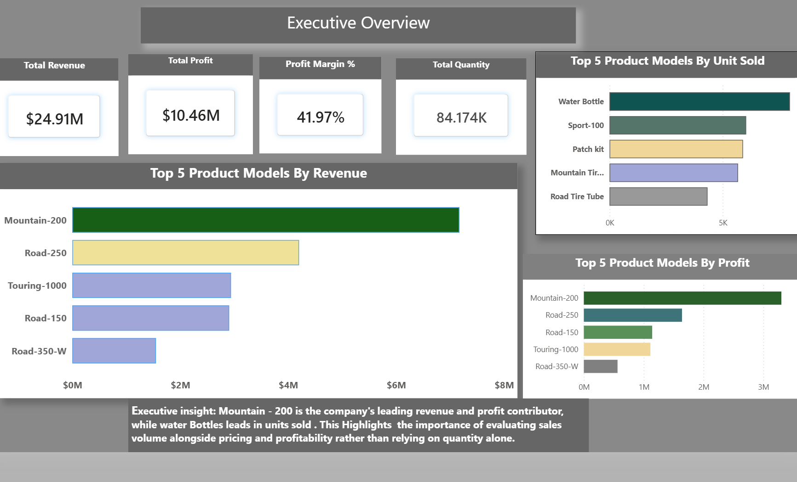

# AdventureWorks Business Performance Analysis | Power BI 

## Project Overview
This project analyzes AdventureWorks sales and product performance using Microsoft Power BI.
The objective is to transform historical sales data into actionable business insights through interactive dashboards, profitability analysis, and scenario modeling.

The analysis focuses on three key business questions:

1.  Which product models contribute the most to revenue, profit, and sales volume?

2.  How has sales performance changed over time, and what factors explain those changes?

3.  How can adjustments to sales quantity, pricing, discounts, and product costs influence profitability?

To address these questions, I developed a three-page Power BI report combining executive performance monitoring, year-over-year sales analysis, and an interactive product profitability simulator.

The project demonstrates my ability to translate business questions into analytical solutions and communicate findings that support data-driven decision-making.
 
 ## Tools & Technical Skills 

- **Power BI Desktop:** Interactive dashboards and data visualization.
- **DAX:** Measures, CALCULATE, SUMX, RANKX, and filter context.
- **Data Modeling:** Table relationships and calculated measures.
- **What-If Analysis:** Dynamic parameters for quantity, discounts, and costs.
- **Business Analytics:** Revenue, profitability, YoY comparisons, and scenario analysis.
- **Data Storytelling:** Executive insights and business recommendations.

 ## Dashboard Overview

### Page 1: Executive Overview

Provides a high-level assessment of business performance through revenue, profit, profit margin, and sales quantity KPIs.

### Page 2: Sales Volume & YoY Analysis

Examines year-over-year sales performance, revenue trends, and changes in product contributions to company revenue.

### Page 3: Product Profitability Simulator

An interactive What-If analysis that evaluates how changes in sales quantity, discounts, and product costs influence projected profitability.

## Key Business Insights

### 1. Revenue Leadership vs. Sales Volume

AdventureWorks generated approximately $24.91 million in revenue and $10.46 million in profit, achieving a 41.97% profit margin.

Mountain-200 emerged as the leading product model by revenue and profit, while Water Bottle led in units sold.

Business Insight: High sales volume does not necessarily translate into high revenue or profitability. Product pricing, costs, and sales quantities must be evaluated together.

### 2. Year-over-Year Performance and Revenue Diversification
Comparing January–June 2021 with the same period in 2022 revealed that Mountain-200:

Maintained its number-one revenue ranking.

Increased revenue by approximately 114.75%.

Experienced a decline in its share of company revenue from 46.82% to 32.32%.

Business Insight: Although Mountain-200 strengthened its absolute revenue performance, its relative contribution declined as other products grew. This indicates a more diversified revenue mix.

### 3. Product Profitability and Scenario Analysis
An interactive profitability simulator was developed to evaluate how changes in sales quantity, discounts, and product costs affect projected profit.

For Mountain-400 W Silver 38:

- Historical sales quantity: 146 units

- Projected sales quantity: 190 units

- Discount assumption: 5%

- Cost-change assumption: 10%

- Historical profit: approximately $51,060

- Projected profit: approximately $51,160

Under these assumptions, increasing sales quantity by approximately 30.1% allows projected profit to recover and slightly exceed historical profit.

Business Recommendation: Before implementing the proposed sales expansion, management should evaluate customer demand, production capacity, and logistical feasibility. Financial projections alone do not establish operational viability.

